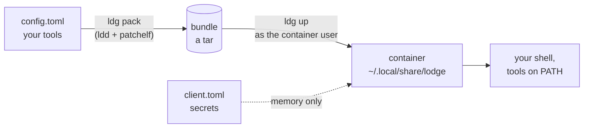

# lodge

**Inject your environment into any container.**

`lodge` (command: `ldg`) copies your tools (editor, shell utilities, AI CLIs, …) and
the shared libraries they need into a running container and opens a shell in it. You
get your toolchain in someone else's image without rebuilding it, and without your
tools having to match the container's (often much older) glibc.

It is also a small [devcontainer](https://containers.dev) runner: `ldg up` starts a
project's `.devcontainer`, runs its hooks and features, then injects your tools on
top. No VS Code, no daemon, nothing added to the image.



## Install

Each release has one static binary per platform, each with a `.sha256`, on the
[releases page](https://github.com/klawr/lodge/releases/latest).

**Linux (x86_64, aarch64)**

```sh
curl -fsSL https://raw.githubusercontent.com/klawr/lodge/master/install.sh | sh
```

It checks the checksum and installs to `~/.local/bin` (`LODGE_BIN_DIR` to change
that, `LODGE_VERSION=v0.4.2` to pin). Run it again to update.

**Windows** (a client only; the target is always Linux). In PowerShell:

```powershell
$d = "$env:LOCALAPPDATA\Programs\ldg"; mkdir -Force $d >$null; Stop-Process -Name ldg -ErrorAction Ignore
curl.exe -fL -o "$d\ldg.exe" https://github.com/klawr/lodge/releases/latest/download/ldg-x86_64-pc-windows-msvc.exe
$p = [Environment]::GetEnvironmentVariable('Path', 'User'); if ($p -notlike "*$d*") { [Environment]::SetEnvironmentVariable('Path', "$p;$d", 'User') }
```

The same lines update it. Open a new terminal afterwards. On Windows:

- `ldg pack` needs Linux or WSL2: pack there, then point `default_bundle` at the file
  or an `oci://` reference ([Bundles](docs/bundles-and-secrets.md)).
- `--remote` uses Windows' own `ssh`, which cannot share a connection: use **key or
  agent auth** ([details](docs/remote.md#from-windows)).
- Local files get mode `0644` in the container (`0755` for folders); a bundle keeps
  its modes, so put programs in a bundle.
- Docker Desktop only exposes published ports (`appPort`).
- CI builds and unit-tests it; the integration tests run on Linux only.

**From source** (any platform; Rust 1.89+)

```sh
cargo install --git https://github.com/klawr/lodge
make install        # in a clone; PREFIX=~/.local/bin for a user install
```

Completions: `ldg completions bash|zsh|fish`. Man page: `ldg man | man -l -`.

## Quickstart

```sh
ldg init          # write config.toml (what is injected) and client.toml (this machine's own)
$EDITOR ~/.config/lodge/config.toml   # uncomment the tools you want
ldg doctor        # check the host and the config
cd my-project     # a project with a .devcontainer
ldg up            # start it, inject your tools, open a shell
ldg               # next time, from anywhere: pick up where you left off
```

No devcontainer, just a machine you can reach?
`ldg --remote me@server --target host up /srv/app` injects into that machine.

Coming back with `ldg up` only attaches; what was injected stays, and `ldg up` says
when your config changed. `--reinject` updates it, `--build` recreates the container.
The container is kept until you `ldg rm` it. To keep a shell alive across a
disconnect, [inject a multiplexer](docs/configuration.md#keeping-a-session-alive).

## Commands

| Command | What it does |
| --- | --- |
| `ldg` | Lists the places you opened a session in, most recent first, and reopens the one you pick. `c` opens the config screen, `r` reinjects, `b` recreates. Keys: [`[keys]`](docs/configuration.md#keys). |
| `ldg up [PATH]` | Start the project's devcontainer and open a shell. `--reinject`, `--build`, `--no-attach`. |
| `ldg attach CONTAINER` | Inject into a running container something else made. Nothing is created or started. |
| `ldg down [PATH]` / `ldg rm [PATH]` | Stop / remove the project's container. |
| `ldg status [PATH]` | State, config drift, injected bundle, placed secrets. |
| `ldg ls` | Every container lodge created. |
| `ldg ports [PATH]` / `ldg logs [PATH]` | Forwarded ports / the forwarder's log (`-f` follows). |
| `ldg clean [PATH]` | Take lodge out of the container (data is kept and listed); `--container NAME` for an attached one. |
| `ldg init` | Write a starting `config.toml` and `client.toml` (`--print` shows them first). |
| `ldg doctor [PATH]` | Check the host, config and what the project needs. |
| `ldg inject [ls]`, `add binary\|data …`, `rm binary\|data …` | Edit the `[[binary]]` and `[[data]]` entries without opening the file. |
| `ldg pack [-o FILE\|oci://REF]` | Pack your tools into a bundle: a file or a registry image. |
| `ldg bundle inspect\|verify REF` | Show what a bundle holds; check it is intact. |
| `ldg bundle use\|add\|rm\|ls` | Choose the default bundle and the others on offer. |
| `ldg cache [clear]` | Show or clear the cache of prepared bundles. |
| `ldg registry login\|logout REGISTRY` | Keep a registry login in this machine's credential store. |
| `ldg secret set\|ls\|rm NAME` | Keep a secret's value in the credential store. |
| `ldg completions SHELL`, `ldg man` | Completions and the man page. |

Global flags: `-r/--remote HOST` (an engine on another machine over ssh),
`--target` (`docker`, `podman`, `kubernetes` for a running pod, or `host` for no
container; also `default_target` in `client.toml`),
`-c/--config FILE` (another config, and the `client.toml` beside it), `-v/-vv/-vvv`
(print every docker/ssh command; ssh's own debug output). `status`, `ls`, `ports`
and `doctor` take `--json`.

## Requirements

- `docker` with `docker compose`. With `--remote` docker runs on the *remote* host;
  locally you only need `ssh`.
- `ldd` and `patchelf`, **only to pack** (when your config lists `[[binary]]`
  entries). Injecting from a bundle needs neither.
- `kubectl`, only for `--target kubernetes` (on the `--remote` host, with it).

`ldg doctor` checks all of this and says what each missing piece would break.

## Documentation

- [Configuration](docs/configuration.md): `config.toml` and `client.toml`, targets.
- [Devcontainers](docs/devcontainers.md): what lodge runs of the spec.
- [Remote containers](docs/remote.md): `--remote` over ssh.
- [Bundles and secrets](docs/bundles-and-secrets.md): carry your setup around;
  deliver API keys without putting them in a bundle.
- [Troubleshooting](docs/troubleshooting.md)
- [Architecture](docs/architecture.md): how the code is organised.

## How it works

When packing, lodge finds each binary's libraries with `ldd` and relinks a copy with
`patchelf` to run against a **bundled** glibc, with a library path relative to the
binary (`$ORIGIN/../lib`). The bundle holds nothing about where it will be installed,
so it fits any user on any machine of its CPU architecture. Injecting writes the real
linker path into the copy and puts everything in `~/.local/share/lodge` **as the
container user**, so lodge never needs root in the container. Sessions put that
folder first on `PATH`.

Because the library path is part of the binary and not `LD_LIBRARY_PATH`, programs
your tools start (git, shells, language servers) keep the container's own glibc, and
`/proc/self/exe` stays correct. Static binaries are copied as they are.

## Limitations

- Host and container share a CPU architecture: injected binaries are host binaries.
- Programs an injected tool starts but that were not injected run against the
  container's glibc (a Mason language server, say). Let the container provide those.
- Tools are on `PATH` only in sessions lodge opens. An IDE terminal or a hand-run
  `docker exec` does not see them, unless a `[[binary]]` sets `target` (a wrapper).
- Libraries loaded at run time (`dlopen`, interpreters) are invisible to `ldd`; list
  them as `[[data]]`.
- A container has one lodge session at a time: attaching ends the earlier one (asking
  first when it is another client's) and removes its secrets
  ([details](docs/bundles-and-secrets.md#secrets)).
- Port forwarding needs the container's bridge IP to be reachable from the engine's
  host: Docker Engine on Linux, or any engine with `--remote`. Docker Desktop and
  rootless Podman forward only published ports (`appPort`).
- `--target host` and `--target kubernetes` work on someone's real machine or pod, so
  lodge never overwrites a file it did not place and cannot act as another user
  ([details](docs/configuration.md#targets)). Linux with `tar` only.
- Change detection covers `devcontainer.json`, the Dockerfile, compose files and local
  features, not the Dockerfile's build context.
- Developed on Linux. Windows is a client only. macOS should work but is untested and
  has no release binary.

## Development

```sh
make              # list the targets
make check        # fmt, clippy -D warnings, unit tests (the CI gate)
make integration  # the real binary against docker (~30 s; needs docker, patchelf)
make dev          # this repo's devcontainer with the ldg built from this tree
```

CI runs the gate, the integration tests, the MSRV build, `cargo deny` and the static
musl builds on every push. Releases come from conventional commits through
[release-please](https://github.com/googleapis/release-please).
