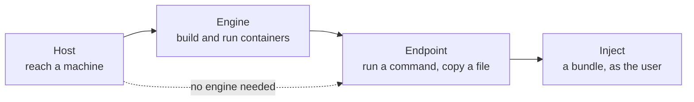
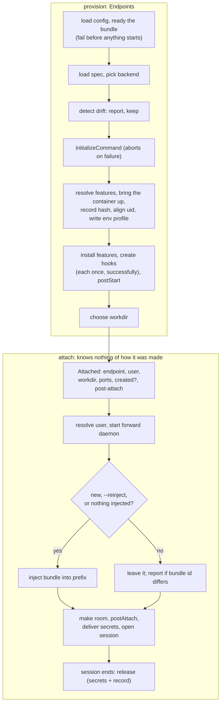
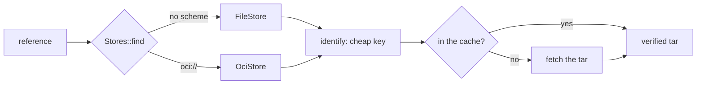

# Architecture

How `ldg` works inside. For usage see the [README](../README.md).

`ldg` does two things with one binary:

1. **Brings your tools into a container you do not control**: copies your editor,
   shell utilities and configs with the libraries they need, relinked to run against
   *your* glibc, not the container's.
2. **Runs a project's devcontainer without VS Code**: reads `devcontainer.json`, brings
   the container up (compose, image or build), runs hooks and features, then does 1.

Everything works against a local engine or, with `--remote`, one reached over ssh.
Nothing but `ldg` is installed on the host and nothing in the image.

## The layers



- **Host** (`trait Host`): a machine we can run commands on: `run` a `Job`,
  `interactive`, `tunnel`, `spawn`, plus a retrying `exec`. `LocalHost`, `SshHost`
  (system `ssh`), `FakeHost` in tests.
- **Engine** (`Runtime`, `Compose`): builds and runs containers *on a `Host`*. Docker
  and Podman are one CLI implementation with two flavors. Only engines provision.
- **Endpoint** (`Env`, `Container`): anything a command runs in and a file is copied
  into: a container, a pod, or a host. A pod and a plain host have no engine; their
  `Endpoints` only find what was there.
- **Inject** takes an endpoint plus plain data and knows nothing of the layers above.

`ldg up` is provision, then attach. `--target` (or `default_target`) picks the
endpoint; it is never probed.

## Commands and control flow

```
ldg                  resume::pick (History → Choose → the command that opened it, with the route it was reached by)
ldg up [PATH]        Endpoints::provision → Attached, then attach:
                     ContainerUser::resolve → ForwardDaemon::start → inject::installed
                     → inject::run (new container, --reinject, or nothing injected yet)
                     → make_room (session::lease; asks before ending another client's session)
                     → Attached::run_post_attach → secret::deliver → session::enter → lease::release
ldg attach NAME      Runtime::existing (not disposable) → is_running (never started) → the same attach
ldg down [PATH]      Lifecycle::stop (an error for a target with no lifecycle)
ldg status [PATH]    Endpoints::status (state, drift) + installed bundle + placed secrets
ldg rm [PATH]        Lifecycle::remove
ldg ls               Lifecycle::list (containers with lodge's project label)
ldg ports [PATH]     forward::active_ports
ldg logs [PATH]      the daemon's log file
ldg clean [PATH|--container NAME]   ForwardDaemon::stop → inject::remove
ldg init             a commented config from the tools found on PATH
ldg doctor [PATH]    host tools, engine, compose, config, binaries, secrets (Endpoints::checks)
ldg inject [ls|add|rm]   config::edit (edits entries in place, checks the result)
ldg pack             bundle::pack::pack_to_file
ldg bundle inspect|verify FILE   bundle::inspect / verify_file
ldg bundle use|add|rm|ls   bundle::choice → bundle::source (checked first) → config::edit
ldg cache [clear]    bundle::cache
ldg registry login|logout  Local::store (secret::registry); asked on a refusal via tools::LoginPrompt
ldg secret set|ls|rm  Local::store (the OS credential store); value from Choose::hidden or stdin
ldg completions, ldg man   generated from the clap definition
ldg _forward …       forward::run_daemon (internal; spawned by `up`)
```

`main.rs` parses arguments and calls `cmd::run`, the **composition root**: the one place
that picks `LocalHost` or `SshHost`, the `TargetKind` (via `cmd/targets.rs`), the
`Toolchain`, `Local`, the bundle stores and sinks, and puts them in a `Ctx`. A child
`ldg` (the forward daemon) is pointed at the same choices by `cmd::respawn_args`.
`cmd/` loads the config **once**, resolves the container user once, and is the only
layer that prints reports or asks the person. Below it, modules take what they need as
arguments and return data.

### What `ldg up` does



The project path is made canonical on the project's host (`Host::canonical_dir`), so one
folder is one container however it is spelled. Hooks and features warn and continue,
except `initializeCommand`. Provision is a `Devcontainer`, a `PlainHostEndpoints` or a
`KubeEndpoints`; attach takes only an `Attached`, so it is tested with a fake container.

## Module map

| Module | Responsibility |
| --- | --- |
| `cli.rs` | clap definitions: subcommands and global flags. |
| `cmd/` | The command layer: one file per group (`attach`, `project`, `doctor`, `init`, `inject`, `bundle`, `configure` = the config screen, `resume` = a bare `ldg`, `browse`, `new_project`, `prompt`/`select` = terminal questions and the list picker). Builds `Ctx`, loads the config, prints. The only place that names concrete types and `crossterm`. |
| `config/` | `config.toml` (`mod`) and `client.toml` (`client`) as types; `ConfigFile`/`ClientFile` paths in `Paths`; strict parsing with "did you mean"; `edit/` changes either file in place and writes it back only if it checks. Schemas in `docs/*.schema.json` are generated from the types. |
| `devcontainer/` | Everything about `devcontainer.json` (below). |
| `bundle/` | A bundle is a portable tar: `manifest`, `archive`, `reader` (verifies in place, never unpacks), `pack`, `choice`, `source` (ready one to inject), `store/` (where bundles come from and go), `cache`, `hash`. |
| `inject/` | Copies a bundle into a container for one `ContainerUser`, as that user (`prefix`, `payload`, `binary`, `data`, `git`, `state`, `remove`). |
| `layout.rs` | Every path lodge writes in a container. Nothing else spells them. |
| `secret/`, `credstore.rs` | `[[secret]]` resolve/place/deliver/clear; the OS credential store (`keyring`, behind `Local::store`); registry logins kept there. |
| `session/` | Opens the shell (`startup_script`: login shell, then prefix `bin/` first on `PATH`), the session `lease`, `terminfo`, reconnect after a lost `--remote` link. |
| `forward/` | Port forwarding: the `ForwardDaemon` trait, the `_forward` loop, one tunnel per forward (`ssh -L` or an in-process TCP proxy). |
| `history.rs` | The places a session was opened in, for a bare `ldg` (`History` trait, `FileHistory`, 50 entries, 0600). |
| `provision.rs`, `plain_host.rs`, `kube.rs` | `TargetKind` and the `Endpoints`/`Attached` seam; a host as an endpoint; a pod as an endpoint. |
| `host/` | `Host`: `local`, `ssh`, `fake`; search of files and projects (`find`). |
| `runtime/` | `Env`, `Container`, `Runtime`, `Compose`, `Inside`, `Acting`, `ContainerUser`, `cli/` (Docker and Podman), strict fakes. |
| `tools/` | Build-time helpers behind interfaces: `DepReader` (`ldd`), `ElfEditor` (`patchelf`), `OciFetcher`/`OciPusher` (`oci/`, the in-process registry client). |
| `local.rs`, `files.rs`, `platform/` | The machine lodge runs on (environment, local files, programs, credential store); the files lodge keeps (`DiskFiles`, `MemoryFiles`); what differs between Unix and Windows. |
| `host_tools.rs` | The helper programs lodge may run (`ssh`, `ldd`, `patchelf`) and what each is needed for; `doctor` reports from it. |
| `shell.rs`, `snapshot.rs`, `tree.rs`, `fingerprint.rs`, `arch.rs`, `keys.rs`, `port.rs`, `tmpfile.rs`, `output.rs` | Quoting, files as a Linux target sees them, ordered tree walks, content hashes, CPU names, key bindings, port specs, scratch files, all output. |
| `conventions.rs`, `doc_facts.rs` | Test only: the architecture rules, and facts the docs state checked against the code. |

### `devcontainer/` and `tools/oci/`

`devcontainer/`: `spec` finds and parses the config on the project's host, `backend`
(`ComposeBackend`, `ContainerBackend`) and `create` bring the container up, `features/`,
`lifecycle`, `profile` and `markers` do features, hooks and once-only markers, `drift`
hashes what the container is built from (`UpToDate`, `Changed`, `Unknown`), and `uid` and
`workdir` handle the user and where the session lands. A container is found by lodge's
name first, then by the editor labels (`foreign`: used as is, never stopped or removed).

`tools/oci/` is a registry client with no helper program, split into `OciFetcher` (read)
and `OciPusher` (write). It knows registries, not what an artifact holds, so features and
bundles share it. A pull is checked end to end (manifests and layers by digest and size)
and retries "not now" answers. A push writes blobs first and the manifest last, into the
tag's index (one image per architecture: this one replaced, the others kept). Logins go
only to a token service over TLS, never to another host on a redirect.

### `bundle/store/`

A bundle is named by a *reference*. Each kind of place has a `BundleStore` (read) and a
`BundleSink` (write), so a machine that only uses bundles never needs a way to write
one. `bundle::source` asks `Stores::find`, `ldg pack` asks `Sinks::find`; each returns
the one that `handles` the reference. A new place is a type per direction and a line in
`cmd::bundle_stores` and `bundle_sinks`.



| Place | `identify` | `fetch` | `put` |
| --- | --- | --- | --- |
| `FileStore`/`FileSink` | hash of the file | the file itself | copy beside the destination, then rename |
| `OciStore`/`OciSink` | `OciFetcher::pin`: one manifest request | `pull` the pinned reference (one layer) | `push` into the tag's index; returns `oci://…@sha256:…` |

Whatever a store returns is verified by `Bundle::verified`, so a layer that is not a
bundle fails there, whoever published it. `conventions.rs` allows concrete stores and
sinks to be named only in `bundle/store/` and `cmd/`, and `oci://` only in `oci.rs`.

## Injection

Injection reads only from a **bundle**, either a reference (a file or registry,
identified, fetched and verified once, cached by what it identified as) or a live pack
of the config (cached by a fingerprint of the config, each source's size and mtime and
the libraries `ldd` finds). Both end in the same injector, prepared *before* anything
starts, so a problem leaves no half-started container.

It runs **as the container user into a prefix that user owns**, never as root
(`runtime::Acting`). The prefix is `~/.local/share/lodge`, or, when the home cannot hold
programs (missing, read-only, `noexec`: checked by running a script there), a private
`/tmp/lodge-<uid>`. lodge does not repair a home it cannot use; data whose target is
under `~` then fails naming the path and user.

- **One copy for the prefix.** Libraries (with the dynamic linker, so they never come
  from different versions) and binaries are one `Snapshot` sent as a single tar, after
  `<prefix>/bin` and `lib` are removed, so a re-injection leaves nothing of the old one.
- **Binaries.** A dynamic binary was packed with a 512-byte placeholder interpreter and
  a library path relative to itself (`$ORIGIN/../lib`). Injection overwrites the
  placeholder in place with `<prefix>/lib/<ld>` (no `patchelf`, same size). It runs
  directly and `/proc/self/exe` stays correct. A static binary is copied. A `target`
  writes a two-line wrapper that `exec`s it.
- **Data** goes to its target owned by the user down to the target. A target that
  exists and was not placed by an earlier injection is replaced with a warning on a
  disposable endpoint, left alone on a host or pod. One lodge placed is replaced silently.
- **Git** `safe.directory` is set with `git config --global`, as the user.

Nothing is written outside the prefix except data targets and wrappers: no
`/etc/profile.d` or `/usr/local/bin`. The session's start-up script puts `<prefix>/bin`
first on `PATH`. The record `<prefix>/injected` is written last, so a failed injection
reads as none. Whether to inject at all is `ldg up`'s decision.

## What lives where

In the container (paths from `layout.rs`):

```
<prefix>/              ~/.local/share/lodge, or /tmp/lodge-<uid>; what `ldg clean` removes
  bin/                 injected binaries, first on the session's PATH
  lib/                 libraries and the dynamic linker, one copy
  injected             last bundle id + wrappers, data and safe.directory entries placed elsewhere
  terminfo/            the terminal's entry, when the container lacked it
  session              who holds the container: <pid> <id> <user@host>
/dev/shm/lodge-secrets-<uid>/   placed secrets (memory only, 0700 dir, 0600 files)
/opt/lodge/state/               one-shot markers (hooks, feature installs)    ┐ the devcontainer's own,
/opt/lodge/devcontainer.hash    fingerprint of the devcontainer inputs        │ written as root at
/etc/profile.d/lodge-env.sh     containerEnv / remoteEnv (+ lodge-feature-<id>.sh) │ creation; `ldg clean`
/tmp/lodge-features/            feature files copied in to run install.sh     ┘ keeps them
```

State lives *in* the container, so it survives reboots and vanishes on recreation with
no host bookkeeping to go stale. Every container lodge creates also carries the label
`dev.lodge.project=<path>`.

On the host:

| Path | Contents |
| --- | --- |
| `~/.config/lodge/config.toml`, `client.toml` | What is injected; what is this machine's own. |
| `~/.cache/lodge/bundles/` | Prepared bundles (four most recently used) and `tags.json`. |
| `~/.local/share/lodge/history.json` | The fifty most recent places (0600: it names folders and hosts). |
| `~/.local/share/lodge/forward-<id>.{log,lock,ports,stop}` | The forward daemon's log, lock (one per container), active forwards and end-note. |
| `$TMPDIR/lodge-ssh/*.sock` | ssh `ControlMaster` sockets (`--remote`). |
| `$TMPDIR/lodge-<pid>-*` | Short-lived staging files, created new and private. |

## Remote mode

With `--remote`, `cmd::run` builds an `SshHost` and docker runs *on the remote host*;
nothing but `host/ssh.rs` knows that.

- `CliEngine` hands its host a `Job`; `SshHost` runs it as `ssh <dest> …`, quoting each
  argument, in the project directory *on the remote* when it reads files.
- **One connection.** `Host::connect` opens it first, with the terminal available; every
  later call is multiplexed over its `ControlMaster` socket, and a tunnel's forward lives
  in it. On Windows there is no `ControlMaster`, so each step connects alone.
- **Repeat-safety.** ssh exiting 255 says the connection failed, not whether the command
  ran, so a step is rerun only if it is safe to run twice. Every remote step is marked
  `Repeat::Safe` (reads, `mkdir -p`, the tar copy, start/stop, `compose up`) or
  `Repeat::Never`, the default (hooks, a feature's `install.sh`, the uid change, the
  session). A safe step is tried up to three times; `LocalHost` never retries.
- **The forward daemon has no terminal**, so every command it runs is `BatchMode`. On a
  host that wants a login only a person can give, it logs why and polls every 20 s
  instead of giving up.
- **Bytes into the container.** `put` streams an in-process tar to `docker cp -q -a -`,
  locally and remotely alike, so no `tar` is needed anywhere.

## Runtime traits

| Trait | A… | Used by |
| --- | --- | --- |
| `Env` | place you can run commands in and copy files into | injection, features, hooks, markers, the stored hash |
| `Container: Env` | `Env` that can be inspected (name, mounts, `reach`, running) and read while stopped | forwarding, workdir, session, drift, `status` |
| `Runtime` | container engine: find, build, run, start, stop | devcontainer backends |
| `Compose` | an engine's compose support | the compose backend, `doctor` |

`Env` carries the primitives (`exec`, `output`, `put`, `write_secret`, `interactive`) and
provides the rest on top (`write_file`, `read_file`, `mkdir_p`, `exists`). An endpoint
reached by commands on a `Host` implements `Inside` (its host, the job that runs a command
as a user, the job that unpacks a tar from stdin, a session, whether it is disposable) and
`runtime::inside` builds the `Env`: user check, retry marking, secrets on stdin, never in
argv. A container, a plain host and a pod are each about forty lines of `Inside`. An
endpoint reached some other way (an API) implements `Env` itself, as `FakeEnv` does.

**Acting as a user.** What lodge does *for a user* goes through `Acting::new(env, &user)`,
an `Env` whose helpers run as them and whose copies are theirs. Injection has no way to
need root; asking for it takes an explicit `exec_root`, which none of it contains.

**Capabilities.** Generic code never asks an engine's name; it asks the endpoint:

| Question | Method | Container | Plain host | Pod |
| --- | --- | --- | --- | --- |
| Where may I write and run programs? | `Env::can_run_in` | probe the home, then `/tmp` | same | same |
| How do files get in? | `Env::put` | in-process tar to `docker cp` | tar on stdin over ssh | tar through `kubectl exec -i` |
| Is this place thrown away? | `is_disposable` | yes | **no** | **no** |
| Reaching ports | `Container::reach` | `Address` (bridge IP) or `Published` (rootless Podman) | `ssh -L` to loopback | `Relayed`: `kubectl port-forward` via `Host::spawn` |
| Act as another user? | | yes (`-u`) | no (`LoginOnly`) | no (`LoginOnly`) |

Non-disposable means a file lodge did not place is left alone, `safe.directory = *` is
not set, and a host must say `uname -s` Linux. Uid mapping and mount labels are decided
at provisioning (`PodmanFlavor`, `devcontainer/uid.rs`); no generic code reads them.
`put` merges a directory's *contents* into `dest`, creates missing parents, and owns
everything it creates by the given owner.

## Choices and how they are wired

Each variation sits behind a small interface, so a new option is one new type plus one
line where the choice is made, and tests swap in fakes.

| Dependency | Interface | Implementations |
| --- | --- | --- |
| How a machine is reached | `host::Host` | `LocalHost`, `SshHost`, `FakeHost` |
| The machine lodge runs on | `local::Local` | `SystemLocal`, `FakeLocal` |
| The container engine | `Runtime`, `Compose`, `Container`, `Env` | `runtime::cli`, `FakeRuntime` |
| Build-time helpers | `DepReader`, `ElfEditor`, `OciFetcher`, `OciPusher` (a `Toolchain`) | `Ldd`, `Patchelf`, `NativeOci` (on `Http`, `Credentials`) |
| Making an endpoint ready | `provision::Endpoints` | `Devcontainer`, `PlainHostEndpoints`, `KubeEndpoints` (each says what `doctor` checks) |
| Port forwarding | `ForwardDaemon`, `Forwarders` | `DetachedDaemon`, `HostForwarders` |
| Where bundles come from and go | `BundleStore`, `BundleSink` | file and `oci://` |
| What is injected | `[[inject]]` data | multiplexers and other tools are data, never named in code |

Pieces compose instead of branching: "docker over ssh" is `Docker::new(host)`, not a
third case. What differs between hosts is asked as a capability (`shares_cwd`, `names`,
`tunnel`). `cmd::build_endpoints` makes the `Endpoints` from `--target`; every command
about the project's container asks it and never knows which kind it is.

To add a **way of reaching machines**, implement `Host` under `host/` and add one arm in
`cmd::run`. To add a **kind of endpoint**, implement `Endpoints`, `Inside` and
`Container` (and `Lifecycle` if lodge creates what it hands back), then one struct and
one line in `cmd/targets.rs`: a `TargetKind` with its name, settings (a serde struct that
refuses unknown keys, read from `[targets.<name>]`, with its schema), `build`, and
`made_of` (the concrete types and the modules that may name them, which `conventions.rs`
turns into a guard). That list alone says which targets exist: `--target`, the
`default_target` choices, the settings and the schema are all read from it. To replace a
**helper tool**, implement `OciFetcher` or `ElfEditor` and swap it in the `Toolchain`.
To add a **place for bundles**, a `BundleStore` and `BundleSink` and a line in each list.

**Not a choice yet** (listed in `conventions.rs`, and the list may only shrink): the
session's terminal check, and a few uses of the standard directories (bundle cache,
temp files, forward logs, finding `ldg`'s own executable). Each moves into `Local` when
a second machine or a test needs it.

## Design decisions

- **No agent on the host.** The transport is the system `ssh`, one call per command over
  a shared connection. An agent adds a binary, a protocol and a version lifecycle for
  little more than a nicer frame; if wanted, it is one more `Host`.
- **Sessions are a shell and nothing else.** No multiplexer, no launch template: inject
  one and start it from the rc file ([how](configuration.md#keeping-a-session-alive)).
- **The docker CLI stays.** `runArgs` are CLI flags, and compose and builds need the CLI
  anyway. It is reached through the engine's `Host`, never spawned directly.
- **Windows is a client.** The target is always Linux; `ldg pack` needs Linux or WSL2.

## Conventions

Mostly enforced by the compiler or a test (`conventions.rs`, clippy).

- **Output** goes through `output` (`info!`, `warning!`, `error!`, … on stderr with a
  `[lodge]` prefix; `line!` for reports, the only thing on stdout). Reports and
  questions belong to `cmd/`.
- **Every dependency is injected**; only `cmd/` names a concrete one, and no code matches
  on a kind of host or engine. Each interface has a fake.
- **One place per external program or crate**: `ssh` in `host/ssh.rs`, `docker` only
  through `runtime/cli/`, `ldd`/`patchelf` in `tools/external.rs`, the HTTP and hash
  crates in `http.rs` and `digest.rs`, `keyring` in `credstore.rs`, `crossterm` in
  `cmd/select.rs`. lodge never runs a local `tar`.
- **Dependencies point one way**: `cmd/` on top, the features below, a foundation
  (`runtime`, `host`, `tools`, `shell`, `layout`, …) that names none of them.
- **Safe strings and paths.** Container paths come from `layout.rs`; anything interpolated
  into a shell goes through `shell::shell_quote`; names from a config, bundle or feature
  are checked before they become a path or a script.
- **Errors.** No `unwrap()`/`expect()` outside tests; ignoring a `Result` needs a stated
  reason. "Could not find out" is never treated as "absent".
- **Docs follow the code**: `doc_facts.rs` checks commands, host tools, targets, links
  and schemas against the code (`make schema` regenerates the schemas).

## Testing

`cargo test` needs no Docker. Unit tests use strict fakes (`FakeEnv` panics on a command
it was not told about, so a test cannot pass because a fake said "success"); scripts
whose behaviour matters also run for real against a temp directory or real processes.

The 43 integration tests (`tests/integration/`, `#[ignore]`d) drive the real `ldg` against
a real engine, a real `registry:2`, a real `sshd` and a fake `kubectl`. Run them with
`make integration` (about 30 s; `T=name` narrows); they need docker with compose,
`patchelf`, python3 and ssh, and clean up after themselves even when they fail.

CI runs fmt, clippy (also for Windows), rustdoc, the unit and integration tests, the MSRV
build, `cargo deny` and the static musl builds; `make check` is the same gate locally.
Releases come from conventional commits through release-please.
