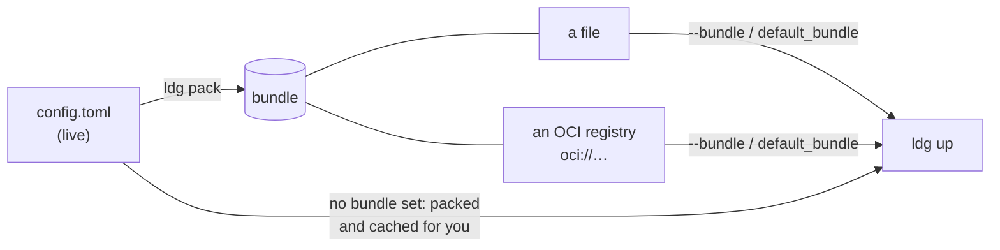
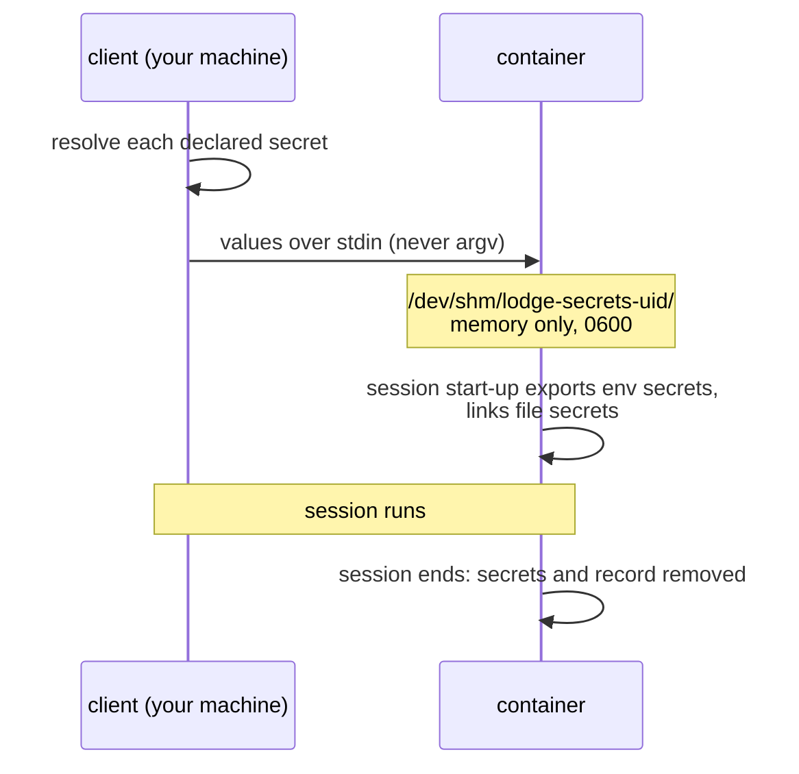
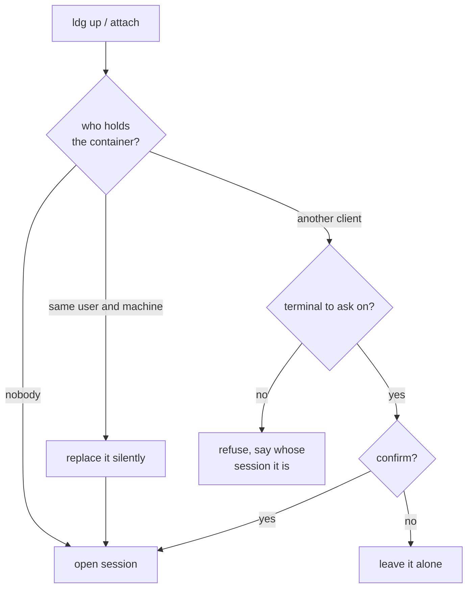

# Bundles and secrets

## Bundles

Injection always works from a **bundle**: a tar holding your tools relinked to a
bundled glibc, their libraries, your data, git settings and a manifest. It is tied to
a CPU architecture, not to a user, home or install path.



Without options, `ldg up` packs your config itself and caches the result in
`~/.cache/lodge/bundles/`, reusing it while nothing it depends on changed (the config,
each source file's size and mtime, the libraries `ldd` finds). `ldg cache` lists the
four most recently used; `ldg cache clear` empties it.

To use your setup on a machine that is not your Linux workstation, pack once and carry
the file:

```sh
ldg pack -o lodge-x86_64.tar          # Linux or WSL2
ldg bundle verify lodge-x86_64.tar    # after copying it (inspect and verify also take oci://…)
ldg up --bundle lodge-x86_64.tar      # anywhere with a container runtime, or ssh with -r
```

or list it under `bundles` in `client.toml` and set `default_bundle`. A configured
bundle replaces the `[[binary]]` and `[[data]]` entries of `config.toml`; `[session]`
stays local.

A bundle is made from `config.toml` alone, so nothing in `client.toml` (targets,
secrets, keys) can end up in one. It can still hold credentials if you list the wrong
folder: `pack` warns about `~/.ssh`, `~/.config/gh`, `~/.claude` and similar.

A machine that only *uses* a bundle needs the bundle, a small `client.toml` and an
empty `config.toml` beside it:

```toml
# deploy/client.toml
bundles        = ["bundle.tar"]    # relative to this file
default_bundle = "bundle.tar"

[[secret]]
name = "ANTHROPIC_API_KEY"
from = { env = "ANTHROPIC_API_KEY" }
as   = "env"
```

```sh
ldg -c deploy/config.toml --remote me@host:2222 up /devel/project
```

### Keeping a bundle in a registry

```sh
ldg pack -o oci://ghcr.io/me/lodge:1                  # build and publish
ldg up --bundle oci://ghcr.io/me/lodge:1              # use it anywhere (-b for short)
ldg up --bundle oci://ghcr.io/me/lodge@sha256:4f1c…   # pinned to exact content
```

A reference with a scheme is a registry; anything else is a file.

**Publishing.** `pack -o oci://…` uploads the bundle and prints the exact `@sha256:…`
reference, which you can pin. A tag holds an **index with one image per architecture**:
publishing from x86_64 and then aarch64 under `:1` gives one tag both use. Publishing
replaces only your architecture's entry; two machines publishing at once can lose one,
so do it one after the other. `--no-clobber` refuses to overwrite (for CI).

Publishing needs a login that may write: `ldg registry login <registry>` (typed hidden or
piped; with 2FA use an access token). It is kept in this machine's credential store, not
in a file or bundle. lodge tries it first, then docker's own login, and at a terminal
asks when a registry refuses
([Troubleshooting](troubleshooting.md#a-bundle-or-a-feature-cannot-be-pulled-or-published)).

**Using.** Each `up` asks the registry what the tag points at (one small request) and
downloads only when it changed. If the registry cannot be reached at all, `up` warns and
uses the bundle the tag named last time, if cached.

- **A bundle is code that runs in your containers.** Pin by digest when the registry is
  not yours.
- **A bundle holds your data and git settings**: publish to a private repository.
  Secrets are never in a bundle.

`ldg bundle inspect|verify` take a file or a reference (always fetched, since a check
must look at the bytes). `ldg status` shows which bundle a container holds and where it
came from. The artifact is an image with one layer, the bundle's tar, so a tool of your
own can publish one too.

### Several bundles

`bundles` lists what is on offer; `default_bundle` (one of them) is used by default;
without it the packed config is.

```sh
ldg bundle ls                              # the default is marked
ldg bundle use oci://ghcr.io/me/lodge:2    # fetched and checked, then made the default
ldg bundle use --live                      # the default is your config, packed (Linux)
ldg bundle use                             # choose from what is on offer
ldg bundle add ~/work.tar                  # on offer, not the default
ldg bundle rm ~/work.tar
```

- `use` checks the bundle **before** touching `client.toml`, so a wrong reference or
  another architecture changes nothing. `pack -o …` puts what it wrote on offer.
- A container keeps the bundle it was injected from: after switching, `ldg up --reinject`
  injects the new one, and `up` says when a container and a run would use different ones.
- With several on offer and no `--bundle`, `up` and `attach` ask which when injecting
  into a new place or with `--reinject`; no terminal means the default. The config
  screen (`c`) also chooses the default.

## Secrets

Anything that must be in the container but not in a bundle (an API key, a token, a
credential file) is declared as `[[secret]]` in `client.toml`, on the machine you attach
from.

```toml
[[secret]]                       # a token from `pass`, as an environment variable
name = "ANTHROPIC_API_KEY"
from = { command = "pass show anthropic" }
as   = "env"

[[secret]]                       # only for some containers
name    = "GH_TOKEN"
from    = { command = "gh auth token" }
as      = "env"
targets = ["build-*"]

[[secret]]                       # a file the tool only reads
name = "deploy_key"
from = { file = "~/.ssh/deploy_key" }
as   = { file = "~/.ssh/deploy_key", mode = "0600" }
```

| field | required | meaning |
| --- | --- | --- |
| `name` | yes | letters, digits, `_`; the variable name for `as = "env"`, else a label. Unique |
| `from` | yes | exactly one of `{ env = "VAR" }`, `{ file = "path" }`, `{ command = "…" }` (stdout, trimmed; 30 s limit, stdin closed), `{ store = "entry" }` (credential store, below) |
| `as` | yes | `"env"`, or `{ file = "/path/in/container", mode = "0600" }` (`~/` is the container user's home) |
| `targets` | no | globs (`*`, `?`) matched against the container name and the host (`local`, or the `--remote` value and its host part). Omitted: every container |

### The credential store

A `store` source reads from your OS credential store (Windows Credential Manager, macOS
Keychain, Linux Secret Service: GNOME Keyring, KeePassXC, …), so neither a file nor
`client.toml` holds the value.

```toml
[[secret]]
name = "CLAUDE_CODE_OAUTH_TOKEN"
from = { store = "claude_token" }
as   = "env"
```

```sh
ldg secret set claude_token     # typed hidden, or: ldg secret set claude_token < file
ldg secret ls                   # the entries your client file reads, and whether each is set
ldg secret rm claude_token
```

The value is never an argument and never printed. The store is per user and machine:
set it on each client that should deliver the value. `ldg doctor` checks that entries
are set. A headless Linux server has no Secret Service; use `env`, `file` or `command`
there.

### How they are delivered



- Values are sent on the command's **stdin**, so they are in neither `ps` nor the `-v`
  trace, and stored only in `/dev/shm`, never in an image layer. lodge prints secret
  *names*, never values; `ldg status` shows what is placed, `ldg doctor` checks sources.
- A source that cannot be resolved is a warning; the session still opens and a value
  already placed is kept.
- What is placed is exactly what the attaching client declares, so deleting a
  `[[secret]]` takes effect on the next attach, as does `ldg clean`.
- lodge only delivers. Which credential a tool prefers, and refreshing it, are the
  tool's business: an API key you declare may beat a subscription login.

### Which credentials to inject

Two kinds, not to be mixed:

- **A secret you hold on the client** (API key, token): read at every attach, gone when
  the session ends, deliverable by any client holding it, nothing to do for a new
  container.
- **A login the tool owns**: you log in inside the container; the tool keeps it in the
  container's home. It lasts as long as the container; lodge never touches it.

Do not declare a `file` secret for a file the tool also **rewrites**: every attach
replaces the container's copy with a link to yours, losing the refresh, and a tool that
rotates refresh tokens leaves your copy stale and can log you out. Use `as = { file … }`
only for files the tool just reads.

For a tool with a login, prefer a **long-lived token** you hold over its credential
file: it does not rotate, so it can be on several clients and containers. A login a
tool keeps in the OS keychain cannot be copied; log in inside the container.

**Claude Code.** Do not copy `.credentials.json`: run `claude setup-token` (a one-year
token, paid plans), `ldg secret set` it and deliver it as `CLAUDE_CODE_OAUTH_TOKEN`.
**GitHub CLI:** `GH_TOKEN` from `gh auth token`. **GitHub Copilot:** being signed in in
VS Code does not sign you in inside the container. Either run `copilot login` there (a
login the tool owns), or deliver `COPILOT_GITHUB_TOKEN` (an OAuth, fine-grained or App
user token, not a classic `ghp_…`), for example
`from = { command = "gh auth token --hostname github.example.com" }`; whether the CLI
accepts that is not documented, so try it.

### One session at a time

A container is one person's workspace with one lodge session at a time. Attaching ends
the session lodge opened earlier and the secrets become the new client's.



The earlier shell is hung up and its `ldg` says who took over. A second terminal from
the same machine ends the first, so use a multiplexer for several panes. A multiplexer
started from the ended shell keeps running; a `docker exec` or IDE terminal is not a
lodge session and is left alone.

### Limits

- Secrets live in `/dev/shm` only as long as their session. A `file` secret is gone for
  every process; an `env` secret stays in the environment of processes the session
  started (a multiplexer) until they end. A session that ends without cleanup (killed
  terminal) leaves them until the next attach. `/dev/shm` is 64 MB in Docker by default.
- **Not protected:** anyone who can run a command in the container as the same user or
  root (`docker exec`, another ssh login) can read the 0600 file or `/proc/<pid>/environ`.
  For a remote target the value crosses ssh and sits in the remote container's memory,
  so you trust that machine's root. Whoever controls the engine controls its secrets.
  A value is never in a bundle, image layer, command line, lodge's output or a config.
