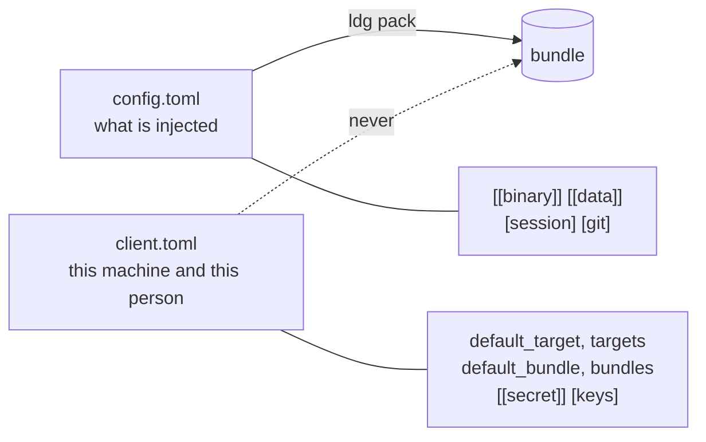

# Configuration

lodge reads two files from `~/.config/lodge/`. Neither has to exist (without a
config you still get a shell, with nothing injected).



| file | holds | travels in a bundle |
| --- | --- | --- |
| `config.toml` | [`[[binary]]`](#binary), [`[[data]]`](#data), [`[session]`](#session), [`[git]`](#git) | yes |
| `client.toml` | [`default_target`](#targets), [`bundles` and `default_bundle`](#bundles-and-default_bundle), [`[[secret]]`](#secret), [`[keys]`](#keys) | never |

A setting is config if it describes *what is injected*; it is the client's if it
depends on where lodge runs or who runs it. A key in the wrong file is an error
that names the right one.

`-c FILE` replaces `config.toml` (it must exist); `client.toml` is the one in the
same folder, so a folder holding both is a complete setup. `ldg init` writes a
commented starting point for each, with the tools found on your `PATH` filled in
(it never overwrites an existing `client.toml`).

Each file is checked as a whole before anything starts: unknown keys (with a "did
you mean"), duplicate names, bad target paths and malformed secrets are reported
together. `ldg doctor` shows the same report.

**Editor completion.** [`config.schema.json`](config.schema.json) and
[`client.schema.json`](client.schema.json) describe the files. `ldg init` adds the
`#:schema` line that taplo / Even Better TOML read; add it by hand otherwise:

```toml
#:schema https://raw.githubusercontent.com/klawr/lodge/master/docs/config.schema.json
```

## Example

```toml
[[binary]]
name      = "nvim"
path      = "/usr/local/bin/nvim"   # host binary to copy in
target    = "~/.local/bin/nvim"     # optional: also write a wrapper script here
copy_deps = true                    # copy shared libs via ldd when packing (default)

[[data]]                            # copied as is, to the same place in the container
path = "/usr/local/share/nvim"
for  = "nvim"                       # only says which program it belongs to

[[data]]
path = "~/.config/nvim"             # ~/… stays under the container user's home
for  = "nvim"

[session]
shell = "/bin/bash"

[git]
safe_directories = ["*"]            # git safe.directory in the container; [] disables
```

## `[[binary]]`

A program: its binary relinked to the bundled glibc, plus its shared libraries.

| field | required | default | meaning |
| --- | --- | --- | --- |
| `name` | yes | | identifier, unique among binaries |
| `path` | yes | | host path (may start with `~/`) |
| `target` | no | none | also write a wrapper script at this path in the container (absolute or `~/…`, no `..`). Without it the binary is on the `PATH` of lodge's sessions |
| `copy_deps` | no | `true` | copy shared libraries found by `ldd` when packing |

## `[[data]]`

A file or folder copied as it is: a program's runtime files, a config, plugins,
shell setup.

| field | required | default | meaning |
| --- | --- | --- | --- |
| `path` | yes | | host path (may start with `~/`) |
| `target` | no | same place as `path` | where it goes (absolute or `~/…`, no `..`) |
| `for` | no | none | the `name` of a `[[binary]]`; informational (the config screen and `doctor` use it) |

A path under your home goes under the container user's home; any other path goes to
the same absolute path. No two entries may share a target.

A program built to run from where it was installed (Neovim) needs the files beside
its binary. For `<prefix>/bin/<name>` lodge offers `<prefix>/share/<name>` and
`<prefix>/lib/<name>` as data when you add the program (`--no-data` skips this), and
`ldg doctor` warns when such files exist and the config does not bring them.

Everything injected belongs to the container user. A target the user cannot create is
made by root in a container; on a real machine it must be somewhere the user can write.
Shell aliases are your shell's own config: inject your `~/.bashrc` with a `[[data]]`
whose `target` is where the shell reads it.

## Editing the config

Run `ldg` and press `c` for the config screen: both files as a form, every value a line.
Enter changes it, `x` removes the entry (or resets a setting), and a change that would
add a problem is refused with the reason. Comments and order in the file are kept. `b`
and `d` add programs and data from a searchable list of what this machine has
(credentials such as `~/.ssh` are never listed), `s` adds a secret, `p` packs a bundle,
`P` publishes it, `o` opens another config file. A file that does not load is still
shown, with the reason on top. The `[targets.<name>]` tables are not in the screen yet.

The same from the command line:

```sh
ldg inject                                     # list the entries
ldg inject add binary rg                       # found on PATH
ldg inject add binary nvim /usr/local/bin/nvim --target '~/.local/bin/nvim'
ldg inject add data ~/.config/nvim --for nvim
ldg inject rm binary rg
```

With `default_bundle` set, these entries are not used until you pack again or drop it.

## `[session]`

lodge opens a shell and nothing else.

| field | default | meaning |
| --- | --- | --- |
| `shell` | `/bin/bash` | must exist in the container (bash, zsh, sh, dash). Started once as a login shell so the profile runs, then as the interactive shell |
| `start` | none | commands run in order just before the shell opens, with the injected tools on `PATH`. `["clear"]` tidies the screen; an `exec` command takes the place of the shell |

### Keeping a session alive

A multiplexer (tmux, zellij, screen) is a tool like any other: inject it and start it
with `start` (or from your shell's rc file). The container keeps it running, so the next `ldg up` lands
in the same session. After a dropped `--remote` connection `ldg` reconnects, opens a
new shell, and the rc file attaches again.

```toml
[[binary]]
name = "tmux"
path = "/usr/bin/tmux"

[[data]]                       # becomes ~/.bashrc in the container
path   = "~/.config/lodge/tmux-rc"
target = "~/.bashrc"

[[data]]
path   = "~/.config/lodge/tmux.conf"
target = "~/.tmux.conf"
for    = "tmux"
```

To attach on every session, without an rc file:

```toml
[session]
start = ["exec tmux new-session -A -s main"]
```

Or with the rc file `tmux-rc` (or add this to the `~/.bashrc` you inject):

```sh
if [ -z "$TMUX" ] && command -v tmux >/dev/null; then
  exec tmux new-session -A -s main
fi
```

`tmux.conf`:

```
set -g default-command bash
```

The last line matters: tmux starts panes as *login* shells, and on Debian and Ubuntu
`/etc/profile` resets `PATH`, hiding everything injected. A plain `bash` pane inherits
the right `PATH` from the tmux server. Any multiplexer needs the same care.

## `[git]`

| field | default | meaning |
| --- | --- | --- |
| `safe_directories` | `["*"]` | registered as git `safe.directory` for the container user; `[]` disables |

## Targets

`client.toml` says where lodge works, with `default_target` or `--target` (default
`docker`), on this machine or the one `--remote` names.

| target | works on | creates containers |
| --- | --- | --- |
| `docker` | a devcontainer on Docker | yes |
| `podman` | a devcontainer on Podman | yes |
| `kubernetes` | a running pod, through `kubectl` | no |
| `host` | the machine itself, no container | no |

Settings for a target go in `[targets.<name>]`; only the chosen target's table is read.

### `docker` and `podman`

```toml
[targets.docker]
context = "colima"      # docker --context colima …

[targets.podman]
connection = "vm"       # podman --connection vm …
```

With Podman lodge adds what a bind-mounted project needs: `--userns=keep-id` when
rootless, and `--security-opt label=disable` for SELinux. A `--userns` in `runArgs` or
a `label=` in `securityOpt` replaces them. Compose needs a provider `podman compose`
finds; lodge adds no user namespace to a compose project (set `userns_mode` in the
compose file). Rootless Podman has no reachable container address, so only published
ports (`appPort`) are forwarded.

### Attaching to a container lodge did not make

`ldg attach CONTAINER` injects into a running container something else started and opens
a shell in the user's home or `--workdir DIR`. It treats the container as somebody's
workload: nothing is created, started or stopped, it acts as the user the container runs
as, and data lodge did not place is left alone. `ldg clean --container CONTAINER` takes
lodge out again; `up`, `down` and `rm` do not know about it.

### `host`: no container

`ldg up [PATH]` injects into the user's prefix on the machine itself (or another one
over `--remote`) and opens a session in `PATH`. Because it is a real machine, lodge acts
only as the user you connect as, never overwrites a file it did not place (it warns), and
sets no `safe.directory = *`. The machine must be Linux with `tar`. `down` and `rm` have
nothing to do; `ldg clean` removes the prefix and wrappers.

### `kubernetes`: a running pod

lodge runs `kubectl` on this machine or the `--remote` one, which needs `kubectl` and
the cluster's credentials. Name the pod:

```toml
[targets.kubernetes]
pod = "dev-0"            # or `selector`
selector = "app=api"     # the one running pod with this label
container = "main"       # kubectl exec -c (default: kubectl's pick)
namespace = "work"       # default: the context's
context = "staging"      # default: the current one
workdir = "/srv/app"     # where a session starts (default: the user's home)
```

A `selector` must match **exactly one running pod**; more is an error that lists
them. The pod is looked up once per run, so the background port forwarder keeps the
one it found until `ldg up` runs again. The `PATH` argument of `ldg up` is a folder on
the host and plays no part: use `workdir`.

**Per project.** A `lodge.toml` in the project folder (read on this machine, even with
`--remote`) may hold `[targets.kubernetes]` and nothing else. What it sets replaces the
same key in your own table (a `pod` or `selector` replaces how you found a pod).

```toml
# my-project/lodge.toml
[targets.kubernetes]
pod = "api-dev-0"
namespace = "my-team"
```

A pod is treated like `host`: the pod's user only, files it did not place are left alone.
The image needs `sh` and `tar` (and `cat` for port detection), and its architecture must
match the bundle. Nothing is created, so a replaced pod needs `ldg up` again and `--build`
is ignored. Listening ports are forwarded with `kubectl port-forward`.

## `bundles` and `default_bundle`

In `client.toml`. `bundles` lists the bundles on offer, each a file or an
`oci://` reference (relative paths are relative to that file's folder).
`default_bundle` is the one to inject instead of packing your entries, and must be one
of `bundles`; without it the config is packed as it is. `--bundle` overrides it for one
run and need not be listed.

```toml
bundles        = ["oci://ghcr.io/me/lodge:2", "~/work.tar"]
default_bundle = "~/work.tar"
```

`ldg bundle use|add|rm|ls` change these without opening the file. See
[Bundles and secrets](bundles-and-secrets.md#several-bundles).

## `[[secret]]`

In `client.toml`. Values (API keys, tokens, credential files) delivered when you
attach and never stored in a bundle. See
[Bundles and secrets](bundles-and-secrets.md#secrets).

## `[keys]`

In `client.toml`. The keys of the interactive screens are yours to change: naming an
action gives it exactly the keys you list (a string is one key, `[]` unbinds), and the
rest keep their defaults. Every hint line is written from this map.

```toml
[keys]
up    = ["up", "ctrl-p"]      # drop j/k
leave = ["esc", "ctrl-c"]     # q no longer leaves a list
pack  = "ctrl-k"
```

A key is a character or one of `up down left right home end enter esc tab backspace
space`, optionally prefixed `ctrl-` or `alt-`. The actions are `up`, `down`, `first`,
`last`, `choose`, `leave`, `mark`, `prev_list`, `next_list`, `clear_line`, `remove`,
`add_binary`, `add_data`, `add_secret`, `pack`, `publish`, `open_file`, `new`, `config`,
`reinject` and `recreate`; each screen's hint line shows the keys in use. Two actions on
one key, or an unknown action or key, are reported with the other problems.
