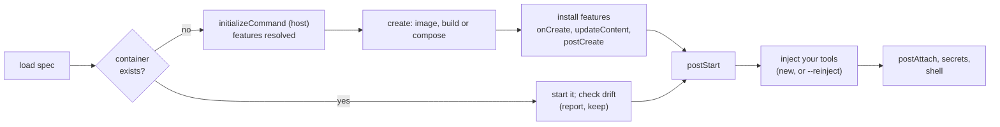

# Devcontainers

`ldg up [PATH]` finds the config under the project path (default: the current folder),
in spec order:

1. `.devcontainer/devcontainer.json`
2. `.devcontainer.json`
3. `.devcontainer/<folder>/devcontainer.json` (one level; with several, the first
   alphabetically wins and a warning lists the choice)

The path is made absolute first, so `ldg up`, `ldg up .` and `ldg up $PWD` are the same
container. The config is JSONC. lodge supports the parts of the spec real
devcontainers use; it does not aim for full conformance.

## Backends

- **`dockerComposeFile`** + `service`: lodge drives `docker compose` under a project
  name from the project path (`-p lodge-<name>-<hash>`), so two projects with compose
  files in `.devcontainer/` do not collide. `runServices` limits what starts.
- **`image`**: runs the image as `sleep infinity` (unless `overrideCommand` is false)
  with the workspace bind-mounted, honouring `workspaceFolder`, `workspaceMount`,
  `mounts` and `runArgs`.
- **`build`** / **`dockerFile`**: builds the image (`context`, `dockerfile`, `target`,
  `args`) and runs it the same way.

For image and build, `privileged`, `capAdd`, `securityOpt`, `init`, `containerUser` and
`appPort` (published on loopback only) apply at creation; with compose, set those in
the compose file.

Every container lodge creates carries the label `dev.lodge.project=<path>` (how `ldg ls`
finds them) and the two labels the devcontainer CLI and VS Code write
(`devcontainer.local_folder`, `devcontainer.config_file`), so "Attach to Running
Container" and the CLI find it too.

The other way round works as well: with no container of its own for a project but one
carrying those labels for the same folder and config (VS Code made it), `ldg up` starts
it if stopped and injects into it, and that is all: no features, no hooks, and `down`
and `rm` refuse to touch it. `ldg up --build` makes lodge's own beside it.

## Lifecycle hooks

`initializeCommand` runs on the host (the remote host with `--remote`) before anything
starts, and a failure stops `ldg up`, as the spec asks. In the container, as
`remoteUser`:

- `onCreateCommand`, `updateContentCommand`, `postCreateCommand` run once
  *successfully*: the marker is written only on exit 0, so a failed hook retries on the
  next `ldg up`.
- `postStartCommand` runs on every `ldg up`; `postAttachCommand` right before the shell.

String (`sh -c`), array (argv) and object-of-named-commands forms all work. A failing
hook is reported but never locks you out.

## Features

A feature is a registry reference (`ghcr.io/devcontainers/features/node:1`) or a project
folder (`./local-feature`; on the remote host with `--remote`). Its `install.sh` runs in
the container as root when it is created, with options as environment variables,
`_REMOTE_USER` / `_CONTAINER_USER` and their homes set, and `containerEnv` written to
`/etc/profile.d`.

lodge pulls registry features itself, so nothing needs installing. The pull is
anonymous unless you kept a login (`ldg registry login <registry>`, see
[Bundles](bundles-and-secrets.md#keeping-a-bundle-in-a-registry)) or ran `docker login`
(config file, or the credential helper named by `credsStore`/`credHelpers`). Everything
pulled is checked against its digest. Failures:
[Troubleshooting](troubleshooting.md#a-bundle-or-a-feature-cannot-be-pulled-or-published).

`dependsOn` features are installed too, before the feature that needs them;
`installsAfter` and `overrideFeatureInstallOrder` order the rest.

Features are installed *in the container*, not baked into the image, so a feature's
`mounts`, `privileged`, `capAdd`, `securityOpt` and `init` apply at creation and its
`entrypoint` is ignored. A failed install is retried on the next `ldg up`.

## Variables and environment

`${localEnv:VAR[:default]}`, `${containerWorkspaceFolder}`, `${localWorkspaceFolder}` and
`${devcontainerId}` are substituted. `containerEnv` and `remoteEnv` are exported to hooks
and written to `/etc/profile.d/lodge-env.sh` for login shells. `updateRemoteUserUID`
(default true) aligns the container user's uid with yours so the workspace is writable.

## Change detection

For an existing container lodge compares a hash of what it is built from
(`devcontainer.json` canonicalised, so comments and formatting do not count; the
Dockerfile; compose files; local feature folders) with the one recorded at creation. On
a difference it says so and keeps the container; `ldg up --build` recreates it. The
Dockerfile's build context and other files under `.devcontainer/` (a hook's output, say)
are not inputs.

## Port forwarding

`forwardPorts` entries are forwarded as soon as the container is up (connections fail
until the service listens):

- `3000`: local 3000 → container 3000.
- `"3000:8080"`: local 3000 → container 8080.
- `"db:5432"`: local 5432 → port 5432 of `db` on the container network (another compose
  service; lodge retries until it is up).

lodge also watches `/proc/net/tcp` in the container and forwards any port that starts
listening (loopback-only listeners are skipped). Forwards bind `127.0.0.1`. One small
daemon per container does this, with a built-in TCP proxy locally or `ssh -L` with
`--remote`. `ldg ports` shows what is forwarded, `ldg logs` the log.

Dynamic forwarding needs the container's bridge IP to be reachable from the engine's
host: Docker Engine on Linux, or any engine with `--remote`. Rootless Podman and Docker
Desktop forward only published ports (`appPort`). A pod needs neither: each port goes
through `kubectl port-forward`.

## Read and ignored

`userEnvProbe`, `portsAttributes`, `shutdownAction`, `waitFor`, `secrets` and
`customizations` are accepted and ignored: IDE behaviour, or not needed here.
