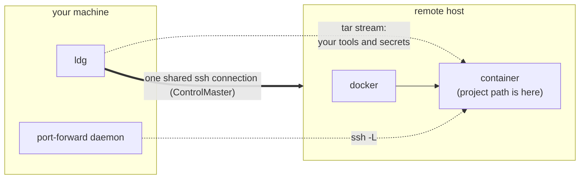

# Remote containers

`ldg -r <dest> up PATH` (or `--remote`) runs the docker CLI *on the remote host* over
ssh, so you need no local docker, only an `ssh` client.

The project path is the path *on the remote host*: the devcontainer config is read
there, `initializeCommand` and builds run there, and features install in the remote
container. Ports are tunnelled back to `127.0.0.1` here. `docker` and `docker compose`
must be on the remote host. Your injected tools stay local and are streamed in over ssh
(packed in-process, so no `tar` is needed locally).

`n` in a bare `ldg` finds a project on this or another machine: this machine, one you
used before, or `another machine…` (typed as below). The remote's projects are those
with a devcontainer config under its home, found with one `find` (one round trip).

The destination is anything your ssh client understands: `user@host`, a `Host` alias
from `~/.ssh/config` (its `User`, `Port`, `IdentityFile`, jump hosts apply), or
`user@host:2222`.

## The connection

lodge opens one ssh connection first, with your terminal available, so a password,
passphrase or 2FA prompt is answered once. The dozens of commands an `ldg up` issues
reuse it (a `ControlMaster` socket under `$TMPDIR/lodge-ssh/`, kept 10 minutes after
last use). A link that goes quiet is dropped after about 45 s.

**Lost connections.** During a step that is safe to repeat (a read, copying files in,
starting a container) lodge reconnects and reruns it, up to three tries. A step that is
not safe (your hooks, a feature's `install.sh`) is not rerun: lodge says so, and running
the same command again picks up where it stopped. If the connection drops under your
shell, `ldg` reconnects by itself (about two and a half minutes; Ctrl-C gives up) and
opens a new shell.

**The forwarding daemon** has no terminal, so it never prompts: it rides on that
connection, or on key or agent auth. On a host that needs a password or 2FA it logs that
it cannot log in and waits (looking every 20 s) instead of exiting; the next `ldg` command
you run in a terminal reconnects and the forwards come back.

Run with `-v` to see each command; `-vv`/`-vvv` add ssh's debug output, written to a file
beside the connection's socket (`ldg` says where).

From a CI runner or Windows, combine `--remote` with a bundle
([Bundles](bundles-and-secrets.md)).

## Secrets with `--remote`

Secrets reach the remote container over the same connection, on stdin, and sit in its
memory for the session. Anyone who is root there, or can run a command in the container,
can read them: use `--remote` only with machines you trust with those values
([Secrets](bundles-and-secrets.md#secrets)).

## From Windows

`ldg` runs natively on Windows as a client for a Linux host
([README](../README.md#install)). Windows' OpenSSH has no `ControlMaster`, so there is
no shared connection: every command connects, authenticates and ends on its own. That is
slower, and:

- Use a **key or an agent** (`ssh-agent` with the key added). A password, a passphrase
  not in the agent or a second factor would be asked for by every command, and the
  daemon could never answer.
- `ldg` still makes one connection first, with the terminal, to tell you early if the
  host is unreachable.
- The forwarding daemon runs in the background without a console window.
- Secrets work as on Linux: `env`, `file`, `command` (through `cmd /C`) and `store`
  (Credential Manager).

`%USERPROFILE%\.ssh\config` aliases, `IdentityFile`, jump hosts and ports apply as on
any ssh.
